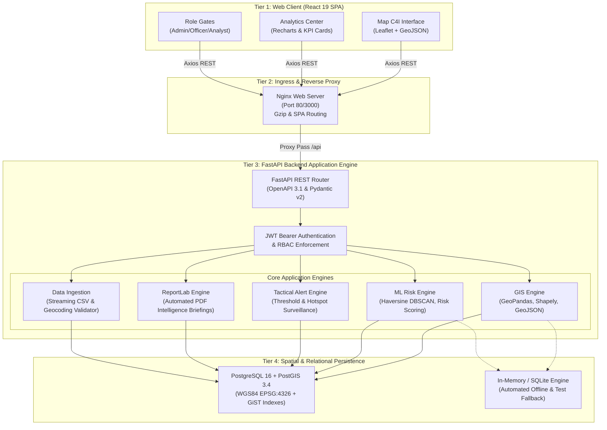
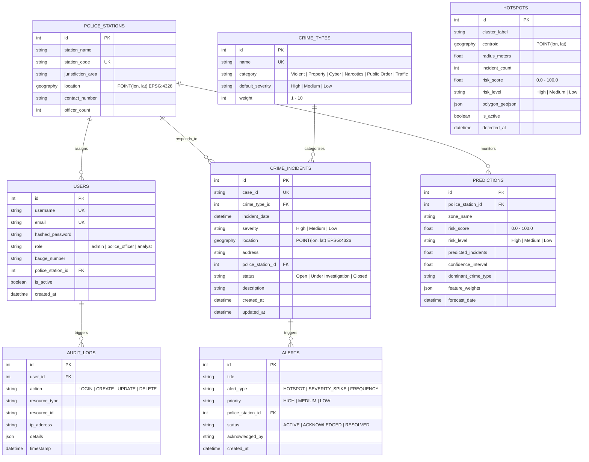
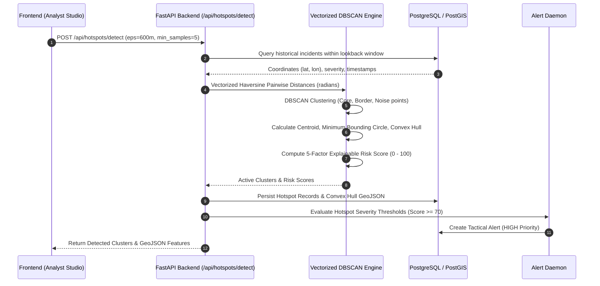

# CRIMEMAP System Architecture & Technical Specification

> **Puducherry Police Hackathon 2026 — Problem Statement 2**  
> *Geospatial Crime Intelligence, Analytics & Decision-Support System*

---

## 1. High-Level Architectural Overview

CRIMEMAP is built on a 4-tier modular, event-driven, micro-service-ready architecture designed for operational resilience, sub-second spatial queries, and military/police grade security.



---

## 2. Database Schema & Entity-Relationship Architecture

The persistence model is managed via SQLAlchemy 2.0 with Alembic versioning. Spatial entities use `GEOGRAPHY(POINT, 4326)` with 2D GiST spatial indexes.



---

## 3. Spatial GIS Engine

### Coordinate Reference System (CRS)
CRIMEMAP strictly uses **WGS84 (EPSG:4326)** for longitude and latitude coordinates:
- Axis order: `(Longitude, Latitude)` in GeoJSON RFC 7946 compliance.
- Coordinates for Puducherry bounding envelope: `[79.76° E - 79.86° E, 11.88° N - 11.98° N]`.

### PostGIS Query Implementation
1. **Radius Search (`ST_DWithin`)**:
   ```sql
   SELECT id, case_id, ST_AsGeoJSON(location) 
   FROM crime_incidents 
   WHERE ST_DWithin(
       location, 
       ST_SetSRID(ST_MakePoint(:lon, :lat), 4326)::geography, 
       :radius_meters
   );
   ```
2. **Bounding Box Envelope (`ST_MakeEnvelope`)**:
   ```sql
   SELECT id, case_id, ST_AsGeoJSON(location) 
   FROM crime_incidents 
   WHERE location && ST_MakeEnvelope(:min_lon, :min_lat, :max_lon, :max_lat, 4326);
   ```
3. **Nearest Police Station (`ST_Distance`)**:
   ```sql
   SELECT id, station_name, ST_Distance(location, ST_SetSRID(ST_MakePoint(:lon, :lat), 4326)::geography) AS distance_meters
   FROM police_stations 
   ORDER BY location <-> ST_SetSRID(ST_MakePoint(:lon, :lat), 4326)::geography 
   LIMIT 1;
   ```

---

## 4. Machine Learning & Predictive Risk Pipeline

The ML pipeline operates asynchronously and on-demand without external heavy dependencies.



---

## 5. Security & Governance

1. **Authentication**: Stateless HMAC-SHA256 JWT tokens with 24-hour expiration window.
2. **Password Security**: Bcrypt with salted rounds ($2b$ format).
3. **Role-Based Access Control (RBAC)**:
   - `Admin`: Unrestricted system oversight, audit inspection, role promotion.
   - `Police Officer`: Operational field logging, case status transition, station PDF downloads.
   - `Analyst`: Advanced spatial exploration, ML hyperparameter tuning, GeoJSON data export.
4. **Audit Trail**: Non-repudiable database log documenting every authentication event, incident mutation, and system configuration change.
