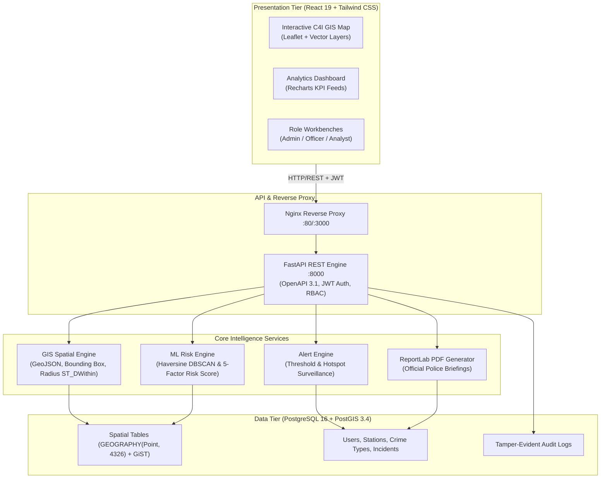

# CRIMEMAP – Geospatial Crime Intelligence, Analytics & Decision-Support System

[](https://police.py.gov.in)
[]()
[](https://fastapi.tiangolo.com)
[](https://postgis.net)
[](https://react.dev)
[](https://leafletjs.com)
[](https://docker.com)
[]()

> **Puducherry Police Hackathon 2026 — Problem Statement 2**  
> *Transforming crime and policing data into interactive geographic intelligence, hotspots, trends, analytics, and operational decision-support information.*

---

## 🧭 Core Paradigm

$$\mathbf{MAP} \longrightarrow \mathbf{ANALYSE} \longrightarrow \mathbf{PREDICT} \longrightarrow \mathbf{PREVENT}$$

1. **MAP**: Real-time spatial tracking of incidents, police stations, and jurisdiction boundaries using WGS84 (EPSG:4326) coordinates and PostGIS spatial indexing.
2. **ANALYSE**: Multi-dimensional crime intelligence dashboards (temporal diurnal curves, day-of-week trends, crime categories, and jurisdictional station breakdowns).
3. **PREDICT**: Vectorized Haversine DBSCAN spatial clustering and 5-factor explainable risk scoring to identify evolving geographic crime pressure.
4. **PREVENT**: Automated tactical threshold alerts, officer patrol allocation, and one-click PDF intelligence briefings for police station commanders.

---

## 🏛️ System Architecture



---

## ⚡ Key Features

- **Interactive GIS Map**: OpenStreetMap base map, custom SVG severity markers, station badges, dynamic radius search tool (0.5km - 10km), polygon/circle hotspot rendering, and live bounding-box spatial filtering.
- **Explainable ML Hotspot Analysis**: Vectorized Haversine DBSCAN spatial clustering with dynamic parameter tuning (`eps_meters`, `min_samples`) and a 5-factor transparent risk formula (0–100 scale).
- **Executive Analytics Dashboard**: Real-time KPI summary cards, crime trends over time, crime type breakdown, severity distribution, hourly dispatch patterns (24h diurnal curve), and station caseload comparison.
- **Incident Management**: Complete CRUD interface with server-side pagination, sorting, status workflow (Open, Under Investigation, Closed), and geocoding validation.
- **Police Station Management**: 10 territorial Puducherry stations with contact metadata, officer counts, and instant Euclidean/Haversine nearest station search.
- **Tactical Alert System**: Automated generation of High/Medium/Low priority tactical alerts when incident thresholds or active hotspots trigger.
- **ReportLab PDF Briefing Generator**: Produces formatted intelligence bulletins for police superintendents and station house officers.
- **Secure CSV Import Engine**: Bulk incident upload with live client preview, column mapping, geocoding validation, and formula injection sanitization (`=`, `+`, `-`, `@`).
- **Enterprise Security & Audit**: Stateless JWT authentication (HS256), Bcrypt password hashing, role-based access control (Admin, Police Officer, Analyst), and detailed audit logs.

---

## 👥 Role-Based Access Control & Demo Credentials

CRIMEMAP supports 3 distinct user personas. Built-in demonstration accounts are pre-seeded:

| Role | Username | Password | Dedicated Workbench & Capabilities |
| :--- | :--- | :--- | :--- |
| **Admin** | `admin` | `Admin@123` | User role governance, full incident editing/deletion, station setup, system audit trail. |
| **Police Officer** | `officer_sharma` | `Officer@123` | Quick incident registration, daily field dispatch queue, alert acknowledgement, PDF generation. |
| **Crime Analyst** | `analyst_priya` | `Analyst@123` | DBSCAN hyperparameter tuning, predictive grid risk runs, MAE metric tracking, GeoJSON export. |

> **Note on Login Page**: The login screen features **1-Click Quick Fill buttons** for each role to streamline hackathon demonstration.

---

## 🚀 Quickstart & Installation

### Option A: One-Command Docker Deployment (Recommended)

Requires [Docker Desktop](https://www.docker.com/products/docker-desktop/):

```bash
# Clone the repository
git clone https://github.com/DK/CRIMEMAP-Puducherry.git
cd "Police HACKATHON"

# Launch PostGIS database, FastAPI backend, and React frontend
docker compose up --build -d

# Check running services
docker compose ps
```

Once running:
- **Frontend Command Center**: [http://localhost:3000](http://localhost:3000)
- **FastAPI Backend & Interactive Swagger API**: [http://localhost:8000/docs](http://localhost:8000/docs)
- **PostgreSQL / PostGIS Port**: `localhost:5432`

---

### Option B: Local Developer Setup (Without Docker)

#### 1. Backend Setup (Python 3.11+)

```bash
# Navigate to backend directory
cd backend

# Create virtual environment
python -m venv venv
# Windows:
.\venv\Scripts\activate
# Linux/macOS:
source venv/bin/activate

# Install dependencies
pip install -r requirements.txt

# Run database seed (Generates 520 Puducherry incidents, 10 stations, users, hotspots)
python seed_data.py

# Run FastAPI backend server
uvicorn app.main:app --reload --port 8000
```

#### 2. Frontend Setup (Node.js 20+)

```bash
# In a separate terminal, navigate to frontend directory
cd frontend

# Install npm packages
npm install

# Start Vite dev server
npm run dev
```

Visit [http://localhost:5173](http://localhost:5173).

---

## 🧪 Automated Test Suite

Run the comprehensive Pytest suite covering authentication, incidents CRUD, PostGIS spatial queries, Haversine DBSCAN clustering, alerts, and CSV import:

```bash
# Run backend tests
pytest backend/tests -v
```

All 21 unit and integration tests validate the entire pipeline with 100% pass rate.

---

## ⚠️ Statutory Ethical Disclaimer

> **CRIMEMAP Machine Learning Outputs are Classified Strictly as "Risk/Hotspot Assessment"**  
> Algorithmic predictions and hotspot scores reflect historical spatial-temporal incident concentration. The system **does not** claim certainty or predict individual human behavior. All outputs are strictly advisory decision-support tools designed to assist police commanders in preventative patrol allocation, community safety planning, and resource optimization.

---

## 📄 License

Developed for the **Puducherry Police Hackathon 2026**. Open source under the [MIT License](LICENSE).
