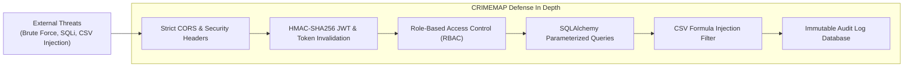

# CRIMEMAP Cybersecurity Architecture & Hardening Guide

> **Puducherry Police Hackathon 2026 — Problem Statement 2**  
> *Defensive Architecture, Cryptographic Standards & Data Integrity Controls*

---

## 1. Threat Model & Security Posture

Law enforcement systems handle sensitive operational intelligence and require defense-in-depth against unauthorized access, data tampering, injection attacks, and lateral privilege escalation.



---

## 2. Authentication & Cryptography

### 2.1 Password Hashing (Bcrypt)
- Passwords are never stored in plaintext.
- Hashed using the **Bcrypt** adaptive hash algorithm ($2b$ format) with unique salt per user:
  ```python
  pwd_context = CryptContext(schemes=["bcrypt"], deprecated="auto")
  hashed = pwd_context.hash(raw_password)
  ```

### 2.2 Stateless JSON Web Tokens (JWT)
- Algorithm: `HS256` (HMAC with SHA-256).
- Payload claims: `sub` (username), `user_id`, `role`, and `exp` (timestamp).
- Secret key loaded exclusively from external environment variable (`JWT_SECRET_KEY`).
- Token expiration: Configurable (default 24 hours).
- Automatic frontend cleanup and session termination on `401 Unauthorized`.

---

## 3. Role-Based Access Control (RBAC) Matrix

Every API endpoint and UI route is strictly gated by role decorators:

| Operation | Required Role | Backend Enforcement |
| :--- | :---: | :--- |
| View Map, Analytics, Stations | All (`admin`, `police_officer`, `analyst`) | `get_current_active_user` |
| Register / Create New Incident | `police_officer`, `admin` | `require_roles(["police_officer", "admin"])` |
| Update Case / Close Case | `police_officer`, `admin` | `require_roles(["police_officer", "admin"])` |
| Delete Incident Record | `admin` | `require_roles(["admin"])` |
| Run DBSCAN & Risk Pipeline | `analyst`, `admin` | `require_roles(["analyst", "admin"])` |
| Acknowledge Tactical Alert | `police_officer`, `admin` | `require_roles(["police_officer", "admin"])` |
| Change User Roles / Governance| `admin` | `require_roles(["admin"])` |
| Access Audit Trail Logs | `admin` | `require_roles(["admin"])` |

---

## 4. Injection & Data Integrity Defenses

### 4.1 SQL Injection Protection
- 100% of database interactions utilize SQLAlchemy 2.0 ORM with parameterized prepared statements.
- Direct string concatenation in SQL queries is strictly banned.

### 4.2 CSV Formula Injection Defense
When importing CSV datasets, malicious spreadsheets could contain executable formulas starting with `=`, `+`, `-`, or `@`. CRIMEMAP sanitizes all imported string cells before persistence:
```python
if cell_value.startswith(('=', '+', '-', '@')):
    cell_value = "'" + cell_value  # Prepend apostrophe to neutralize execution
```

### 4.3 Cross-Site Scripting (XSS) & CORS Whitelisting
- React handles JSX escaping by default, preventing reflected XSS.
- Backend restricts CORS strictly to configured client origins:
  ```python
  app.add_middleware(
      CORSMiddleware,
      allow_origins=settings.CORS_ORIGINS,
      allow_credentials=True,
      allow_methods=["GET", "POST", "PUT", "DELETE"],
      allow_headers=["*"],
  )
  ```
- Nginx injects protective HTTP headers: `X-Frame-Options: SAMEORIGIN`, `X-Content-Type-Options: nosniff`, `X-XSS-Protection: 1; mode=block`.

---

## 5. Audit Logging & Accountability

All state mutations (logins, role adjustments, incident creation/deletion, alert status changes) are recorded in the `audit_logs` table:
- Timestamp (UTC)
- User ID & Username
- Action Type (`LOGIN`, `CREATE`, `UPDATE`, `DELETE`)
- Resource Target & Record ID
- Origin Client IP Address
- Payload details snapshot
